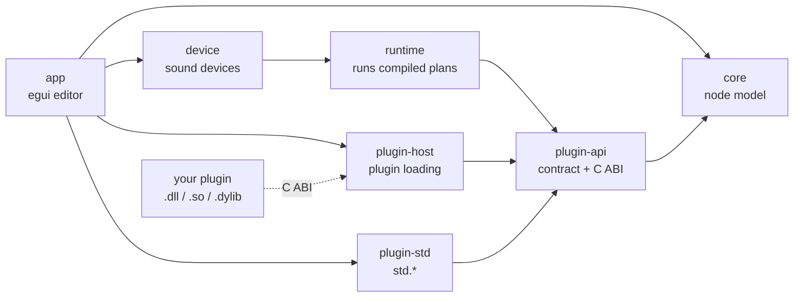

<div align="center">

# v-signal-nodes

**A node-based signal processing editor written in Rust**

[](https://github.com/VanoSpalevoy/v-signal-forge/actions/workflows/ci.yml)


[](LICENSE)

**English** · [Русский](README.ru.md)

</div>

Build signal processing out of nodes (generators, processors, outputs) wired
together on a canvas. Every node type comes from a plugin, so the editor itself
knows no node types and grows without changes to its code.

The signals can be of any kind, with a lean towards electrical and radio ones:

- **analog**: continuous signals, modeled as finely sampled streams;
- **sampled**: discrete in time, continuous in value;
- **digital**: discrete in both time and value, down to bit streams.

Sound is just one kind of sampled signal. For now, the model covers sampled
real-valued streams; formats for complex (IQ) samples of radio signals and for
bits are planned.

> [!NOTE]
> **Status: early development.** You can build graphs in the editor and run them:
> in real time on a sound device (output and input), or once on background threads,
> recording the output to a WAV file if you like. You can edit parameters while it
> runs, but you can't save graphs yet. The plugin API is still changing, and
> plugins built for one API version are refused by hosts built for another.

## Contents

- [Features](#features)
- [Getting started](#getting-started)
- [Using the editor](#using-the-editor)
- [Project layout](#project-layout)
- [Writing a plugin](#writing-a-plugin)
- [Roadmap](#roadmap)
- [Development](#development)
- [License](#license)

## Features

- **A canvas where nodes never overlap.** Zoom (0.5–2×), scroll bars, a dot
  grid and snap to grid. A dropped node takes a nearby free spot or pushes its
  neighbours aside, and a preview shows the result while you drag.
- **Wires that go around nodes.** Connections are routed around nodes (A* on an
  orthogonal grid, with rounded corners) and drawn with a color gradient from
  the source node to the target. Only routes near a moved node are recomputed,
  so large graphs stay smooth.
- **A graph that stays valid.** Cycles, self-connections and sockets that don't
  fit (different rates, or channel counts that differ with neither side mono)
  are refused, each input has at most one source, and the bottom panel shows why
  a connection was refused.
- **A sample rate of the project's choosing.** The graph runs at a rate chosen for
  its signals (44.1 kHz to 384 kHz in a list, any from 1 kHz to 10 MHz typed in),
  not the device's: the output is resampled to the device's rate, with the band above
  its half filtered out. The rate is saved with the graph. A node frequency above a
  quarter of the sample rate gets a warning in the bottom panel, with the rate it
  needs.
- **Devices in and out.** The system's default sound devices or any chosen in the
  toolbar. An input node takes a channel of the input device, resampled to the
  project's rate; the input device runs only while the graph has an input node.
  Device nodes say which voltage is the device's full scale.
- **Runs to a file.** A run once can write what the output nodes deliver to a
  32-bit float WAV file, chosen in the system's save dialog: full scale applied,
  nothing clipped.
- **Plugins.** Rust crates linked into the editor, or dynamic libraries loaded
  through a C ABI, with an API version check and panics caught at the boundary.
- **Two languages.** An English or Russian interface. Plugins translate their
  own node labels, and nodes on the canvas switch language with the editor.
- **Node windows.** A node can have windows, opened with buttons in its header:
  its advanced parameters, and windows its plugin declares, such as a plot. A
  declared window has two buttons: a preview floating inside the editor, and a
  separate system window that can leave the main window, be above or behind it and
  fill the screen. The editor draws them, so a plugin needs no UI code, also across
  the C ABI.
- **Standard nodes for analog electrical signals,** where every sample is a voltage
  in volts: `std.generator` (sine/square/saw/triangle, frequency, amplitude, phase,
  offset; generators of one frequency keep their set phases, so 0° and 180° add up
  to zero), `std.amplifier` (inverting if negative, with optional clipping at its
  supply), `std.summing_amplifier` (sums its inputs sample by sample),
  `std.device_input` (a channel of the input device, in volts at the set full scale),
  `std.device_output` (its full scale, 1 V by default, is the device's), `std.oscilloscope` (a
  triggered sweep on a screen in its window, optionally interpolated by sin(x)/x like
  on a digital oscilloscope; it needs no output node and nothing it looks at is
  heard) and `std.dual_beam_oscilloscope` (the same with two inputs on one screen, in
  two colors with numbered markers, one sweep triggered by the input you choose).

## Getting started

Requires Rust 1.99.1. The version is pinned in `rust-toolchain.toml`, so rustup
installs it for you.

```sh
git clone https://github.com/VanoSpalevoy/v-signal-forge.git
cd v-signal-forge
cargo run -p v-signal-nodes-app               # run the editor
cargo build -p v-signal-nodes-app --release   # release build: target/release/v-signal-nodes
```

On Linux, eframe needs the usual X11/Wayland development packages, for example
on Debian or Ubuntu:

```sh
sudo apt-get install libxcb-render0-dev libxcb-shape0-dev libxcb-xfixes0-dev libxkbcommon-dev libssl-dev
```

## Using the editor

| Action                       | How                                                    |
|------------------------------|--------------------------------------------------------|
| Add a node                   | Click it in the palette, or drag it onto the canvas    |
| Move a node                  | Drag its body (`Esc` while dragging cancels the move)  |
| Connect                      | Click an output socket, then an input socket           |
| Disconnect                   | Right-click a socket                                   |
| Delete a node                | The cross in its header                                |
| Change a number              | Drag its field sideways (slower with `Shift`), or click and type |
| Change a choice or a toggle  | Click it on the node                                   |
| Advanced parameters          | The `⋯` button in the header opens them in a window    |
| Clear the selection          | Click empty canvas or press `Esc`                      |
| Zoom, snap to grid, sample rate, devices, language | Toolbar                          |
| Run in real time / once / once to a file | `Space` / `Cmd`/`Ctrl`+`Enter` / `Cmd`/`Ctrl`+`Shift`+`Enter`, or the Run menu |

Each input takes one connection. Connecting an input that is already connected
replaces its old connection. The bottom panel lists the connections and shows
why a connection was refused.

## Project layout



| Crate                 | What it is                                                     |
|-----------------------|----------------------------------------------------------------|
| `crates/app`          | The egui/eframe editor                                         |
| `crates/core`         | Node model and graph: node specs, parameters, sockets, translations, connection rules; no dependencies |
| `crates/plugin-api`   | The plugin contract and its C ABI (`ffi`)                      |
| `crates/plugin-host`  | Loads plugins (linked or from a dynamic library), builds nodes and their processors |
| `crates/plugin-std`   | The standard nodes (`std.*`), the reference plugin            |
| `crates/runtime`      | Graph processing: runs a compiled plan, on a real-time thread or in one parallel pass |
| `crates/device`       | The first device driver: sound outputs and inputs, through `cpal` |

API docs: `cargo doc --workspace --no-deps --open`.

## Writing a plugin

A plugin depends only on `v-signal-nodes-plugin-api`. It registers one
`NodeProvider` per node type. A provider describes its node type with a
`NodeSpec` and creates a `NodeProcessor`, which holds the signal state, for every
node placed on the canvas.

```rust
use v_signal_nodes_plugin_api::*;

pub struct MyPlugin;

impl Plugin for MyPlugin {
    fn name(&self) -> &str {
        "my"
    }

    fn version(&self) -> &str {
        env!("CARGO_PKG_VERSION")
    }

    fn register(&self, registrar: &mut dyn Registrar) {
        registrar.register_node(Box::new(Invert));
    }
}

/// Declared once: the spec and `process` both use it.
const ENABLED: ToggleParam = ToggleParam("enabled");

struct Invert;

impl NodeProvider for Invert {
    fn spec(&self) -> NodeSpec {
        NodeSpec::new("my.invert", "Invert", NodeKind::Processor)
            .input(NodeSocket::signal_in("In"))
            .output(NodeSocket::signal_out("Out"))
            .param(ENABLED.spec("Enabled", true))
            .translate(
                "ru",
                [
                    (TextKey::Name, "Инверсия"),
                    (TextKey::Input(0), "Вход"),
                    (TextKey::Output(0), "Выход"),
                    (ENABLED.name_key(), "Включено"),
                ],
            )
    }

    fn create_processor(&self) -> Box<dyn NodeProcessor> {
        Box::new(InvertProcessor)
    }
}

struct InvertProcessor;

impl NodeProcessor for InvertProcessor {
    fn process(&mut self, io: &mut ProcessIo<'_>) -> Result<(), PluginError> {
        let sign = if io.get(ENABLED)? { -1.0 } else { 1.0 };
        let input = io.input(0);
        for (out, sample) in io.output(0).iter_mut().zip(input) {
            *out = sample * sign;
        }
        Ok(())
    }
}

// Only for a plugin built as a dynamic library (crate-type = ["cdylib"]).
export_plugin!(MyPlugin);
```

### Node spec rules

- **Type ids** are namespaced by the plugin, for example `my.invert`, and must
  be unique across all loaded plugins.
- **Roles and sockets must match:** an `Input` needs outputs and no inputs (the
  host fills them from the input device), a `Generator` needs an output (it may
  also take modulation inputs), a `Processor` needs inputs and outputs, and an
  `Output` or `Instrument` needs an input. The role picks the palette group and the
  default color; `NodeSpec::color` sets a color of its own. On `Input` and `Output`
  nodes the host reads two parameters itself, if there: `FULL_SCALE` (the voltage of
  the device's full scale) and, on inputs, `DEVICE_CHANNEL` (the device channel the
  first channel takes).
- **Sockets** carry a rate (`SignalRate::Sample`: a value per sample, the
  signal itself; `SignalRate::Control`: one value per block) and a channel count
  (`with_channels`, one channel by default). `NodeSocket::signal_in` /
  `signal_out` and `control_in` / `control_out` build single-channel sockets. A socket's buffer holds its channels one
  after another; `ProcessIo::input_channels` / `output_channels` split it.
- **Parameters** are declared as key constants (`NumberParam`, `ChoiceParam`,
  `ToggleParam`) that build the `ParamSpec` and read the value with
  `io.get(KEY)`, so the id and kind can't drift apart. The editor shows a parameter
  on the node, or in the node's separate window if its spec is marked
  `.advanced()`. A number can name its unit, `.unit(Unit::Hertz)`: the editor
  then knows a frequency when it sees one and warns when it is set above a quarter of
  the sample rate.
- **Labels are written in English in the spec.** Translations are keyed by
  `TextKey`: the node name, a socket by index, a parameter by id, or a choice
  option by parameter id and index. That way, renaming the English label keeps
  its translations.
- **Validation:** `NodeSpec::validate` (also run when the plugin loads) rejects
  empty ids, duplicate sockets or parameters, out-of-range defaults, and
  translations of labels that don't exist.

### Processor life cycle

- The host calls `prepare(sample_rate, max_frames)` before the first `process`
  and again when either value changes. That's the place to allocate memory,
  because `process` runs on the real-time thread.
- `process` gets at most `max_frames` frames per call. Outputs start zeroed.
- A `PluginError` keeps its message inside itself (up to `MAX_ERROR_LEN` bytes), so
  failing in `process` doesn't allocate. Build the message with `format_args!`,
  not `format!`: `PluginError::new(format_args!("no option {index}"))`.
- `reset` clears the signal history (phase, filter state) when processing
  restarts or jumps.
- Panics in dynamic-library plugins are caught at the C ABI boundary. This
  requires `panic = "unwind"`, which is the default.

### Testing a node

The `testing` feature of `plugin-api` adds `testing::Harness`, which runs one
node's processor without a host, the way the host would. It starts with the
spec's default parameters and changes them by key, prepares the processor before
the first block, moves the run's position on from block to block, and collects
the frames published to plot windows:

```toml
[dev-dependencies]
v-signal-nodes-plugin-api = { workspace = true, features = ["testing"] }
```

```rust
let mut gain = Harness::new(&MyGain).sample_rate(48_000.0).with(GAIN, 0.5);
assert_eq!(gain.run(&[&[1.0, -2.0]]), [[0.5, -1.0]]);

let mut scope = Harness::new(&MyScope).with(SWEEP, 1.0);
scope.run(&[&signal]);
let frame = &scope.plotted(SCREEN)[0]; // x_step, beams, trace
```

A test names only the parameters it cares about, so a new parameter elsewhere in
the spec doesn't break it.

### Adding a plugin to the editor

For now, add the crate as a dependency of `crates/app` and load it in
`builtin_plugins` in `crates/app/src/editor.rs`. `PluginHost::load_library` can
already load a dynamic library, but the editor doesn't call it yet.

## Roadmap

- [x] Canvas, nodes, connections, wires routed around nodes
- [x] Plugin API: linked plugins and a C ABI
- [x] Localized interface and node labels
- [x] CI on Linux, macOS and Windows
- [x] Graph in `core` with connection checks and generational node ids
- [x] Graph runtime: real-time processing and an offline pass
- [x] Sound devices in and out, chosen in the toolbar, with a full scale in volts
- [x] Project sample rate apart from the device's, resampled both ways
- [x] Running once to a WAV file
- [x] Node windows drawn by the editor: plots, single- and dual-beam oscilloscopes
- [x] Parameter units, warning about too few samples per period
- [ ] Sample formats beyond real numbers: complex (IQ) and digital (bits)
- [ ] Different sample rates in one graph (decimation, interpolation)
- [ ] More devices and files: SDRs, other ADCs/DACs, reading signal files (WAV, SigMF)
- [ ] Bridges to other plugins and devices: SoapySDR, FMI 3.0 models (FMU), CLAP
- [x] Editing node parameters
- [ ] Saving and loading graphs, undo and redo
- [ ] Selecting and moving several nodes at once
- [ ] Loading external plugins from the editor

## Development

```sh
cargo fmt --all --check
cargo clippy --workspace --all-targets -- -D warnings
cargo test --workspace
RUSTDOCFLAGS="-D warnings" cargo doc --workspace --no-deps --document-private-items
cargo deny check licenses   # needs `cargo install cargo-deny --locked`
```

CI runs these checks on Linux, macOS and Windows; the format and license checks
run on Linux only. Every `unsafe` block needs a `// SAFETY:` comment
(`clippy::undocumented_unsafe_blocks`), and all public items of `plugin-api`
must be documented.

## License

BSD 3-Clause; see [LICENSE](LICENSE).

On Linux the device driver links ALSA's `libasound` (LGPL-2.1) dynamically, and the
file dialog loads the system's `libdbus` (AFL-2.1 or GPL-2.0, used under AFL-2.1)
at run time to reach the desktop portal; both are system libraries and not part of
this program.
