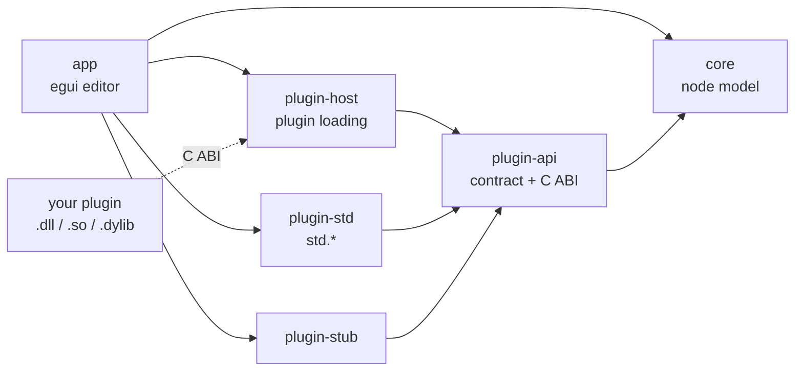

<div align="center">

# v-signal-nodes

**A node-based signal processing editor written in Rust**

[](https://github.com/VanoSpalevoy/v-signal-forge/actions/workflows/ci.yml)


[](LICENSE)

**English** · [Русский](README.ru.md)

</div>

Build signal processing out of nodes (generators, processors, outputs) wired
together on a canvas. Every node type comes from a plugin, so the editor itself
knows no node types and grows without changes to its code.

The signals can be of any kind, with a lean towards electrical and radio ones:

- **analog**: continuous signals, modeled as finely sampled streams;
- **sampled**: discrete in time, continuous in value;
- **digital**: discrete in both time and value, down to bit streams.

Sound is just one kind of sampled signal. For now, the model covers sampled
real-valued streams; formats for complex (IQ) samples of radio signals and for
bits are planned.

> [!NOTE]
> **Status: early development.** You can build graphs in the editor, but nothing
> runs yet: the graph runtime isn't connected to the editor. You can't edit parameters or save
> graphs yet either. The plugin API is still changing, and plugins built for one
> API version are refused by hosts built for another.

## Contents

- [Features](#features)
- [Getting started](#getting-started)
- [Using the editor](#using-the-editor)
- [Project layout](#project-layout)
- [Writing a plugin](#writing-a-plugin)
- [Roadmap](#roadmap)
- [Development](#development)
- [License](#license)

## Features

- **A canvas where nodes never overlap.** Zoom (0.5–2×), scroll bars, a dot
  grid and snap to grid. A dropped node takes a nearby free spot or pushes its
  neighbours aside, and a preview shows the result while you drag.
- **Wires that go around nodes.** Connections are routed around nodes (A* on an
  orthogonal grid, with rounded corners) and drawn with a color gradient from
  the source node to the target. Only routes near a moved node are recomputed,
  so large graphs stay smooth.
- **A graph that stays valid.** Cycles, self-connections and sockets that don't
  fit (different rates, or channel counts that differ with neither side mono)
  are refused, each input has at most one source, and the bottom panel shows why
  a connection was refused.
- **Plugins.** Rust crates linked into the editor, or dynamic libraries loaded
  through a C ABI, with an API version check and panics caught at the boundary.
- **Two languages.** An English or Russian interface. Plugins translate their
  own node labels, and nodes on the canvas switch language with the editor.
- **Standard nodes:** `std.source` (sine/square/saw/triangle), `std.gain`,
  `std.mixer`, `std.sink`.

## Getting started

Requires Rust 1.99.1. The version is pinned in `rust-toolchain.toml`, so rustup
installs it for you.

```sh
git clone https://github.com/VanoSpalevoy/v-signal-forge.git
cd v-signal-forge
cargo run -p v-signal-nodes-app               # run the editor
cargo build -p v-signal-nodes-app --release   # release build: target/release/v-signal-nodes
```

On Linux, eframe needs the usual X11/Wayland development packages, for example
on Debian or Ubuntu:

```sh
sudo apt-get install libxcb-render0-dev libxcb-shape0-dev libxcb-xfixes0-dev libxkbcommon-dev libssl-dev
```

The `dev` profile is optimized (`opt-level = 1`, dependencies at 3), because the
unoptimized editor stutters when it routes connections.

## Using the editor

| Action                       | How                                                    |
|------------------------------|--------------------------------------------------------|
| Add a node                   | Click it in the palette, or drag it onto the canvas    |
| Move a node                  | Drag its body (`Esc` while dragging cancels the move)  |
| Connect                      | Click an output socket, then an input socket           |
| Disconnect                   | Right-click a socket                                   |
| Delete a node                | The cross in its header                                |
| Clear the selection          | Click empty canvas or press `Esc`                      |
| Zoom, snap to grid, language | Toolbar                                                |

Each input takes one connection. Connecting an input that is already connected
replaces its old connection. The bottom panel lists the connections and shows
why a connection was refused.

## Project layout



| Crate                 | What it is                                                     |
|-----------------------|----------------------------------------------------------------|
| `crates/app`          | The egui/eframe editor                                         |
| `crates/core`         | Node model and graph: node specs, parameters, sockets, translations, connection rules; no dependencies |
| `crates/plugin-api`   | The plugin contract and its C ABI (`ffi`)                      |
| `crates/plugin-host`  | Loads plugins (linked or from a dynamic library) and builds nodes |
| `crates/plugin-std`   | The standard nodes (`std.*`), the reference plugin            |
| `crates/plugin-stub`  | A do-nothing node used to test the plugin → editor path       |
| `crates/runtime`      | Graph processing: runs a compiled plan block by block; early skeleton |

API docs: `cargo doc --workspace --no-deps --open`.

## Writing a plugin

A plugin depends only on `v-signal-nodes-plugin-api`. It registers one
`NodeProvider` per node type. A provider describes its node type with a
`NodeSpec` and creates a `NodeProcessor`, which holds the DSP state, for every
node placed on the canvas.

```rust
use v_signal_nodes_plugin_api::*;

pub struct MyPlugin;

impl Plugin for MyPlugin {
    fn name(&self) -> &str {
        "my"
    }

    fn version(&self) -> &str {
        env!("CARGO_PKG_VERSION")
    }

    fn register(&self, registrar: &mut dyn Registrar) {
        registrar.register_node(Box::new(Invert));
    }
}

/// Declared once: the spec and `process` both use it.
const ENABLED: ToggleParam = ToggleParam("enabled");

struct Invert;

impl NodeProvider for Invert {
    fn spec(&self) -> NodeSpec {
        NodeSpec::new("my.invert", "Invert", NodeKind::Processor)
            .input(NodeSocket::signal_in("In"))
            .output(NodeSocket::signal_out("Out"))
            .param(ENABLED.spec("Enabled", true))
            .translate(
                "ru",
                [
                    (TextKey::Name, "Инверсия"),
                    (TextKey::Input(0), "Вход"),
                    (TextKey::Output(0), "Выход"),
                    (ENABLED.name_key(), "Включено"),
                ],
            )
    }

    fn create_processor(&self) -> Box<dyn NodeProcessor> {
        Box::new(InvertProcessor)
    }
}

struct InvertProcessor;

impl NodeProcessor for InvertProcessor {
    fn process(&mut self, io: &mut ProcessIo<'_>) -> Result<(), PluginError> {
        let sign = if io.get(ENABLED)? { -1.0 } else { 1.0 };
        let input = io.input(0);
        for (out, sample) in io.output(0).iter_mut().zip(input) {
            *out = sample * sign;
        }
        Ok(())
    }
}

// Only for a plugin built as a dynamic library (crate-type = ["cdylib"]).
export_plugin!(MyPlugin);
```

### Node spec rules

- **Type ids** are namespaced by the plugin, for example `my.invert`, and must
  be unique across all loaded plugins.
- **Roles and sockets must match:** a `Generator` needs an output (it may also
  take modulation inputs), a `Processor` needs inputs and outputs, and an
  `Output` needs an input. The role picks the palette group and the default
  color; `NodeSpec::color` sets a color of its own.
- **Sockets** carry a rate (`SignalRate::Sample`: a value per sample, the
  signal itself; `SignalRate::Control`: one value per block) and a channel count
  (`with_channels`, one channel by default). `NodeSocket::signal_in` /
  `signal_out` and `control_in` / `control_out` build single-channel sockets. A socket's buffer holds its channels one
  after another; `ProcessIo::input_channels` / `output_channels` split it.
- **Parameters** are declared as key constants (`NumberParam`, `ChoiceParam`,
  `ToggleParam`) that build the `ParamSpec` and read the value with
  `io.get(KEY)`, so the id and kind can't drift apart.
- **Labels are written in English in the spec.** Translations are keyed by
  `TextKey`: the node name, a socket by index, a parameter by id, or a choice
  option by parameter id and index. That way, renaming the English label keeps
  its translations.
- **Validation:** `NodeSpec::validate` (also run when the plugin loads) rejects
  empty ids, duplicate sockets or parameters, out-of-range defaults, and
  translations of labels that don't exist.

### Processor life cycle

- The host calls `prepare(sample_rate, max_frames)` before the first `process`
  and again when either value changes. That's the place to allocate memory,
  because `process` runs on the real-time thread.
- `process` gets at most `max_frames` frames per call. Outputs start zeroed.
- `reset` clears the signal history (phase, filter state) when processing
  restarts or jumps.
- Panics in dynamic-library plugins are caught at the C ABI boundary. This
  requires `panic = "unwind"`, which is the default.

### Adding a plugin to the editor

For now, add the crate as a dependency of `crates/app` and load it in
`builtin_plugins` in `crates/app/src/editor.rs`. `PluginHost::load_library` can
already load a dynamic library, but the editor doesn't call it yet.

## Roadmap

- [x] Canvas, nodes, connections, wires routed around nodes
- [x] Plugin API: linked plugins and a C ABI
- [x] Localized interface and node labels
- [x] CI on Linux, macOS and Windows
- [x] Graph in `core` with connection checks and generational node ids
- [ ] Graph runtime: real-time processing and an offline pass
- [ ] Sample formats beyond real numbers: complex (IQ) and digital (bits)
- [ ] Different sample rates in one graph (decimation, interpolation)
- [ ] Device and file I/O: SDRs, ADCs/DACs, sound cards, signal files (SigMF)
- [ ] Bridges to other plugins and devices: SoapySDR, FMI 3.0 models (FMU), CLAP
- [ ] Editing node parameters
- [ ] Saving and loading graphs, undo and redo
- [ ] Selecting and moving several nodes at once
- [ ] Loading external plugins from the editor

## Development

```sh
cargo fmt --all --check
cargo clippy --workspace --all-targets -- -D warnings
cargo test --workspace
RUSTDOCFLAGS="-D warnings" cargo doc --workspace --no-deps --document-private-items
cargo deny check licenses   # needs `cargo install cargo-deny --locked`
```

CI runs these checks on Linux, macOS and Windows; the format and license checks
run on Linux only. Every `unsafe` block needs a `// SAFETY:` comment
(`clippy::undocumented_unsafe_blocks`), and all public items of `plugin-api`
must be documented.

## License

BSD 3-Clause; see [LICENSE](LICENSE).
