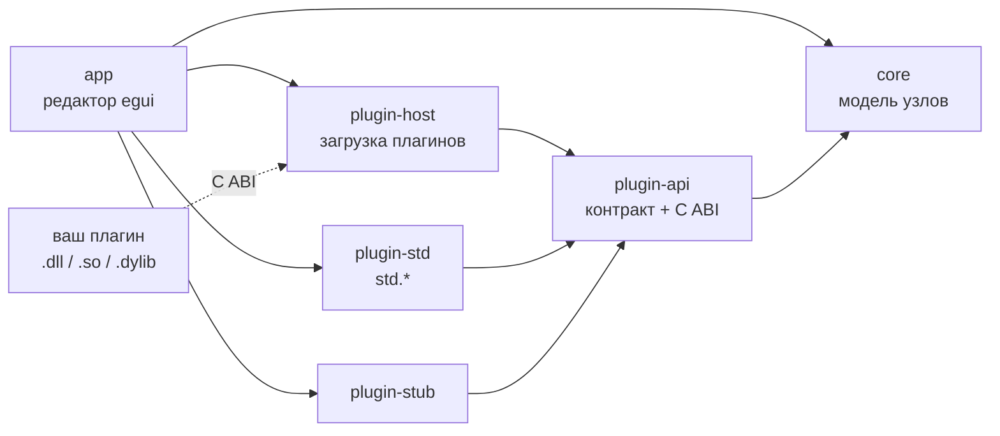

<div align="center">

# v-signal-nodes

**Узловой редактор графов сигналов и звука на Rust**

[](https://github.com/VanoSpalevoy/v-signal-forge/actions/workflows/ci.yml)


[](LICENSE)

[English](README.md) · **Русский**

</div>

Соберите обработку сигнала из узлов (генераторы, обработчики, выходы),
соединённых проводами на холсте. Все виды узлов приходят из плагинов, так что сам
редактор не знает ни одного типа узла и расширяется без правок его кода.

> [!NOTE]
> **Проект на ранней стадии.** Графы в редакторе уже строятся, но звука пока нет:
> исполнителя графа (runtime) ещё нет. Параметры узлов пока не редактируются, а
> схемы не сохраняются. API плагинов ещё меняется, и хост отказывается загружать
> плагины, собранные под другую версию API.

## Содержание

- [Возможности](#возможности)
- [Быстрый старт](#быстрый-старт)
- [Работа в редакторе](#работа-в-редакторе)
- [Устройство проекта](#устройство-проекта)
- [Как написать плагин](#как-написать-плагин)
- [Планы](#планы)
- [Разработка](#разработка)
- [Лицензия](#лицензия)

## Возможности

- **Холст без наложений.** Масштаб 0,5–2×, полосы прокрутки, точечная сетка и
  привязка к ней. Отпущенный узел занимает ближайшее свободное место или
  раздвигает соседей, а во время перетаскивания видно, где всё окажется.
- **Провода в обход узлов.** Соединения прокладываются вокруг узлов (A* по
  ортогональной сетке со скруглёнными углами) и рисуются градиентом от цвета
  узла-источника к цвету узла-приёмника. Пересчитываются только маршруты рядом с
  перемещённым узлом, поэтому большие схемы не тормозят.
- **Граф всегда корректен.** Циклы и соединение узла с самим собой отклоняются,
  у каждого входа не больше одного источника, а причина отказа видна в нижней
  панели.
- **Плагины.** Rust-крейты, вкомпилированные в редактор, или динамические
  библиотеки через C ABI с проверкой версии API и перехватом паник на границе.
- **Два языка.** Интерфейс на русском и английском. Плагины переводят подписи
  своих узлов сами, и узлы на холсте переключают язык вместе с редактором.
- **Стандартные узлы:** `std.source` (синус, меандр, пила, треугольник),
  `std.gain`, `std.mixer`, `std.sink`.

## Быстрый старт

Нужен Rust 1.99.1. Версия закреплена в `rust-toolchain.toml`, rustup поставит её
сам.

```sh
git clone https://github.com/VanoSpalevoy/v-signal-forge.git
cd v-signal-forge
cargo run -p v-signal-nodes-app               # запустить редактор
cargo build -p v-signal-nodes-app --release   # релизная сборка: target/release/v-signal-nodes
```

На Linux eframe нужны обычные пакеты разработки X11/Wayland, например на Debian
или Ubuntu:

```sh
sudo apt-get install libxcb-render0-dev libxcb-shape0-dev libxcb-xfixes0-dev libxkbcommon-dev libssl-dev
```

Профиль `dev` собирается с оптимизациями (`opt-level = 1`, зависимости — 3):
без них прокладка проводов заметно подтормаживает.

## Работа в редакторе

| Действие                     | Как                                                    |
|------------------------------|--------------------------------------------------------|
| Добавить узел                | Щёлкнуть его в палитре или перетащить на холст         |
| Переместить узел             | Тащить за корпус (`Esc` во время перетаскивания отменяет) |
| Соединить                    | Щёлкнуть выходной сокет, затем входной                 |
| Разъединить                  | Правый щелчок по сокету                                |
| Удалить узел                 | Крестик в заголовке узла                               |
| Снять выделение              | Щелчок по пустому холсту или `Esc`                     |
| Масштаб, привязка, язык      | Панель инструментов                                    |

У каждого входа одно соединение: подключение к занятому входу заменяет старое.
Нижняя панель показывает список соединений и причину, по которой соединение не
удалось.

## Устройство проекта



| Крейт                 | Что это                                                        |
|-----------------------|----------------------------------------------------------------|
| `crates/app`          | Редактор на egui/eframe                                        |
| `crates/core`         | Модель узлов: спецификации, параметры, сокеты, переводы; без зависимостей |
| `crates/plugin-api`   | Контракт плагинов и его C ABI (`ffi`)                          |
| `crates/plugin-host`  | Загрузка плагинов (вкомпилированных и из динамических библиотек), создание узлов |
| `crates/plugin-std`   | Стандартные узлы `std.*` — эталонный плагин                    |
| `crates/plugin-stub`  | Узел-пустышка для проверки пути «плагин → редактор»            |
| `crates/runtime`      | Исполнение графа; пока заготовка                               |

Документация API: `cargo doc --workspace --no-deps --open`.

## Как написать плагин

Плагин зависит только от `v-signal-nodes-plugin-api` и регистрирует по одному
`NodeProvider` на каждый тип узла. Провайдер описывает тип узла через `NodeSpec`
и создаёт `NodeProcessor` — объект с состоянием обработки — для каждого узла на
холсте.

```rust
use v_signal_nodes_plugin_api::*;

pub struct MyPlugin;

impl Plugin for MyPlugin {
    fn name(&self) -> &str {
        "my"
    }

    fn register(&self, registrar: &mut dyn Registrar) {
        registrar.register_node(Box::new(Invert));
    }
}

struct Invert;

impl NodeProvider for Invert {
    fn spec(&self) -> NodeSpec {
        NodeSpec::new("my.invert", "Invert", NodeKind::Processor)
            .input(NodeSocket::audio_in("In"))
            .output(NodeSocket::audio_out("Out"))
            .param(ParamSpec::toggle("enabled", "Enabled", true))
            .translate(
                "ru",
                [
                    (TextKey::Name, "Инверсия"),
                    (TextKey::Input(0), "Вход"),
                    (TextKey::Output(0), "Выход"),
                    (TextKey::param("enabled"), "Включено"),
                ],
            )
    }

    fn create_processor(&self) -> Box<dyn NodeProcessor> {
        Box::new(InvertProcessor)
    }
}

struct InvertProcessor;

impl NodeProcessor for InvertProcessor {
    fn process(&mut self, io: &mut ProcessIo<'_>) -> Result<(), PluginError> {
        let sign = if io.toggle(0) { -1.0 } else { 1.0 };
        let input = io.input(0);
        for (out, sample) in io.output(0).iter_mut().zip(input) {
            *out = sample * sign;
        }
        Ok(())
    }
}

// Только для плагина-динамической библиотеки (crate-type = ["cdylib"]).
export_plugin!(MyPlugin);
```

### Правила спецификаций

- **Идентификатор типа** начинается с имени плагина (`my.invert`) и уникален
  среди всех загруженных плагинов.
- **Роль соответствует сокетам:** у `Generator` только выходы, у `Processor` —
  входы и выходы, у `Output` — только входы.
- **Подписи в спецификации пишутся по-английски**, переводы привязаны к ключам
  `TextKey`: имя узла, сокет по номеру, параметр по id, вариант выбора по id
  параметра и номеру. Поэтому при переименовании английской подписи переводы не
  теряются.
- **Проверка.** `NodeSpec::validate` (вызывается и при загрузке плагина)
  отклоняет пустые id, повторяющиеся сокеты и параметры, значения по умолчанию
  вне диапазона и переводы несуществующих подписей.

### Жизненный цикл обработчика

- Хост вызывает `prepare(sample_rate, max_frames)` перед первым `process` и
  снова при изменении любого из значений. Память выделяется здесь: `process`
  работает в аудиопотоке.
- `process` получает не больше `max_frames` отсчётов за вызов, выходы приходят
  обнулёнными.
- `reset` сбрасывает историю сигнала (фазу, состояние фильтров) при переходе
  воспроизведения.
- Паники плагинов из динамических библиотек перехватываются на границе C ABI;
  для этого нужен `panic = "unwind"` (он и так по умолчанию).

### Подключение к редактору

Пока плагин подключается как зависимость `crates/app` и загружается в
`builtin_plugins` (`crates/app/src/editor.rs`). `PluginHost::load_library` уже
умеет загружать динамические библиотеки, но редактор её ещё не вызывает.

## Планы

- [x] Холст, узлы, соединения, провода в обход узлов
- [x] Плагинный API: вкомпилированные плагины и C ABI
- [x] Локализация интерфейса и подписей узлов
- [x] CI на Linux, macOS и Windows
- [ ] Граф в `core` с проверками соединений и поколенческими id узлов
- [ ] Исполнитель графа: обработка в реальном времени и офлайн-проход
- [ ] Редактирование параметров узлов
- [ ] Сохранение и загрузка схем, отмена и повтор действий
- [ ] Выделение и перемещение нескольких узлов сразу
- [ ] Загрузка внешних плагинов из редактора

## Разработка

```sh
cargo fmt --all --check
cargo clippy --workspace --all-targets -- -D warnings
cargo test --workspace
RUSTDOCFLAGS="-D warnings" cargo doc --workspace --no-deps --document-private-items
```

CI запускает эти проверки на Linux, macOS и Windows (форматирование — только на
Linux). Каждый блок `unsafe` сопровождается комментарием `// SAFETY:`
(`clippy::undocumented_unsafe_blocks`), а все публичные элементы `plugin-api`
должны быть задокументированы.

## Лицензия

BSD 3-Clause — см. [LICENSE](LICENSE).
