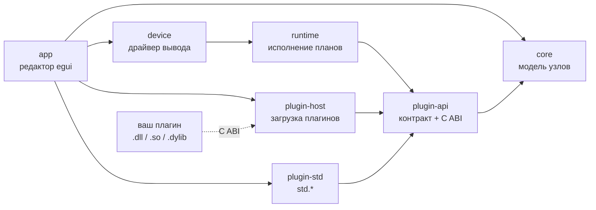

<div align="center">

# v-signal-nodes

**Узловой редактор обработки сигналов на Rust**

[](https://github.com/VanoSpalevoy/v-signal-forge/actions/workflows/ci.yml)


[](LICENSE)

[English](README.md) · **Русский**

</div>

Соберите обработку сигнала из узлов (генераторы, обработчики, выходы),
соединённых проводами на холсте. Все виды узлов приходят из плагинов, так что сам
редактор не знает ни одного типа узла и расширяется без правок его кода.

Сигналы могут быть любыми, с упором на электрические и радиосигналы:

- **аналоговые** — непрерывные, моделируются потоком частых отсчётов;
- **дискретизированные** — дискретные по времени, непрерывные по значению;
- **цифровые** — дискретные и по времени, и по значению, вплоть до потоков битов.

Звук — лишь один из видов дискретизированного сигнала. Пока модель покрывает
потоки вещественных отсчётов; форматы для комплексных отсчётов (IQ) радиосигналов
и для битов запланированы.

> [!NOTE]
> **Проект на ранней стадии.** Графы можно строить в редакторе и запускать: в
> реальном времени на устройстве вывода по умолчанию или один раз в фоновых потоках,
> но такой прогон пока только показывает итог в панели отладки. Параметры можно менять
> прямо во время работы, а вот схемы пока не сохраняются. API плагинов ещё меняется, и
> хост отказывается загружать плагины, собранные под другую версию API.

## Содержание

- [Возможности](#возможности)
- [Быстрый старт](#быстрый-старт)
- [Работа в редакторе](#работа-в-редакторе)
- [Устройство проекта](#устройство-проекта)
- [Как написать плагин](#как-написать-плагин)
- [Планы](#планы)
- [Разработка](#разработка)
- [Лицензия](#лицензия)

## Возможности

- **Холст без наложений.** Масштаб 0,5–2×, полосы прокрутки, точечная сетка и
  привязка к ней. Отпущенный узел занимает ближайшее свободное место или
  раздвигает соседей, а во время перетаскивания видно, где всё окажется.
- **Провода в обход узлов.** Соединения прокладываются вокруг узлов (A* по
  ортогональной сетке со скруглёнными углами) и рисуются градиентом от цвета
  узла-источника к цвету узла-приёмника. Пересчитываются только маршруты рядом с
  перемещённым узлом, поэтому большие схемы не тормозят.
- **Граф всегда корректен.** Циклы, соединение узла с самим собой и
  несовместимые сокеты (разная частота или разное число каналов, если ни одна
  сторона не моно) отклоняются, у каждого входа не больше одного источника, а
  причина отказа видна в нижней панели.
- **Частота отсчётов выбирается под проект.** Граф работает на частоте, выбранной
  под его сигналы (44,1–384 кГц из списка или любая от 1 кГц до 10 МГц вручную), а
  не под устройство: на выходе сигнал пересчитывается на частоту устройства, а полоса
  выше её половины отфильтровывается. Частота сохраняется вместе с графом. Если
  частота какого-то узла выше четверти частоты отсчётов, нижняя панель
  предупреждает, что отсчётов на период мало, и подсказывает нужную частоту.
- **Плагины.** Rust-крейты, вкомпилированные в редактор, или динамические
  библиотеки через C ABI с проверкой версии API и перехватом паник на границе.
- **Два языка.** Интерфейс на русском и английском. Плагины переводят подписи
  своих узлов сами, и узлы на холсте переключают язык вместе с редактором.
- **Окна узлов.** У узла могут быть окна, которые открываются кнопками в его
  заголовке: расширенные параметры и окна, объявленные плагином, например график.
  У объявленного окна две кнопки: предпросмотр прямо в редакторе и отдельное окно
  системы, которое может выходить за пределы главного, быть над ним или за ним и
  занимать весь экран. Рисует их редактор, поэтому плагину не нужен код интерфейса,
  в том числе через C ABI.
- **Стандартные узлы для аналоговых электрических сигналов,** где каждый отсчёт — это
  напряжение в вольтах: `std.generator` (генератор: синус, меандр, пила, треугольник,
  частота, амплитуда, фаза, смещение; генераторы одной частоты держат заданные фазы,
  поэтому 0° и 180° в сумме дают ноль), `std.amplifier` (усилитель, при отрицательном
  усилении инвертирующий, с необязательным ограничением по питанию),
  `std.summing_amplifier` (сумматор, отсчёт за отсчётом), `std.device_output` (выход
  на устройство, 1 В — полная шкала), `std.oscilloscope` (осциллограф: ждущая развёртка
  на экране в своём окне, по желанию с интерполяцией sin(x)/x, как в цифровом
  осциллографе; выходной узел ему не нужен, и то, на что он смотрит, не слышно) и
  `std.dual_beam_oscilloscope` (двухлучевой осциллограф: то же с двумя входами на одном
  экране, двумя цветами с номерами лучей, одна развёртка запускается от выбранного входа).

## Быстрый старт

Нужен Rust 1.99.1. Версия закреплена в `rust-toolchain.toml`, rustup поставит её
сам.

```sh
git clone https://github.com/VanoSpalevoy/v-signal-forge.git
cd v-signal-forge
cargo run -p v-signal-nodes-app               # запустить редактор
cargo build -p v-signal-nodes-app --release   # релизная сборка: target/release/v-signal-nodes
```

На Linux eframe нужны обычные пакеты разработки X11/Wayland, например на Debian
или Ubuntu:

```sh
sudo apt-get install libxcb-render0-dev libxcb-shape0-dev libxcb-xfixes0-dev libxkbcommon-dev libssl-dev
```

## Работа в редакторе

| Действие                     | Как                                                    |
|------------------------------|--------------------------------------------------------|
| Добавить узел                | Щёлкнуть его в палитре или перетащить на холст         |
| Переместить узел             | Тащить за корпус (`Esc` во время перетаскивания отменяет) |
| Соединить                    | Щёлкнуть выходной сокет, затем входной                 |
| Разъединить                  | Правый щелчок по сокету                                |
| Удалить узел                 | Крестик в заголовке узла                               |
| Изменить число               | Тащить поле вбок (медленнее с `Shift`) или щёлкнуть и ввести |
| Изменить выбор или переключатель | Щёлкнуть его на узле                               |
| Расширенные параметры        | Кнопка `⋯` в заголовке открывает их в отдельном окне   |
| Снять выделение              | Щелчок по пустому холсту или `Esc`                     |
| Масштаб, привязка, частота отсчётов, язык | Панель инструментов                       |

У каждого входа одно соединение: подключение к занятому входу заменяет старое.
Нижняя панель показывает список соединений и причину, по которой соединение не
удалось.

## Устройство проекта



| Крейт                 | Что это                                                        |
|-----------------------|----------------------------------------------------------------|
| `crates/app`          | Редактор на egui/eframe                                        |
| `crates/core`         | Модель узлов и граф: спецификации, параметры, сокеты, переводы, правила соединений; без зависимостей |
| `crates/plugin-api`   | Контракт плагинов и его C ABI (`ffi`)                          |
| `crates/plugin-host`  | Загрузка плагинов (вкомпилированных и из динамических библиотек), создание узлов и их обработчиков |
| `crates/plugin-std`   | Стандартные узлы `std.*` — эталонный плагин                    |
| `crates/runtime`      | Исполнение графа: скомпилированный план в потоке реального времени или за один параллельный прогон |
| `crates/device`       | Первый драйвер устройства: вывод по умолчанию через `cpal`     |

Документация API: `cargo doc --workspace --no-deps --open`.

## Как написать плагин

Плагин зависит только от `v-signal-nodes-plugin-api` и регистрирует по одному
`NodeProvider` на каждый тип узла. Провайдер описывает тип узла через `NodeSpec`
и создаёт `NodeProcessor` — объект с состоянием обработки — для каждого узла на
холсте.

```rust
use v_signal_nodes_plugin_api::*;

pub struct MyPlugin;

impl Plugin for MyPlugin {
    fn name(&self) -> &str {
        "my"
    }

    fn version(&self) -> &str {
        env!("CARGO_PKG_VERSION")
    }

    fn register(&self, registrar: &mut dyn Registrar) {
        registrar.register_node(Box::new(Invert));
    }
}

/// Объявлен один раз: им пользуются и спецификация, и `process`.
const ENABLED: ToggleParam = ToggleParam("enabled");

struct Invert;

impl NodeProvider for Invert {
    fn spec(&self) -> NodeSpec {
        NodeSpec::new("my.invert", "Invert", NodeKind::Processor)
            .input(NodeSocket::signal_in("In"))
            .output(NodeSocket::signal_out("Out"))
            .param(ENABLED.spec("Enabled", true))
            .translate(
                "ru",
                [
                    (TextKey::Name, "Инверсия"),
                    (TextKey::Input(0), "Вход"),
                    (TextKey::Output(0), "Выход"),
                    (ENABLED.name_key(), "Включено"),
                ],
            )
    }

    fn create_processor(&self) -> Box<dyn NodeProcessor> {
        Box::new(InvertProcessor)
    }
}

struct InvertProcessor;

impl NodeProcessor for InvertProcessor {
    fn process(&mut self, io: &mut ProcessIo<'_>) -> Result<(), PluginError> {
        let sign = if io.get(ENABLED)? { -1.0 } else { 1.0 };
        let input = io.input(0);
        for (out, sample) in io.output(0).iter_mut().zip(input) {
            *out = sample * sign;
        }
        Ok(())
    }
}

// Только для плагина-динамической библиотеки (crate-type = ["cdylib"]).
export_plugin!(MyPlugin);
```

### Правила спецификаций

- **Идентификатор типа** начинается с имени плагина (`my.invert`) и уникален
  среди всех загруженных плагинов.
- **Роль соответствует сокетам:** `Generator` нужен выход (входы модуляции тоже
  можно), `Processor` — входы и выходы, `Output` — вход. Роль задаёт группу в
  палитре и цвет по умолчанию; свой цвет задаёт `NodeSpec::color`.
- **Сокеты** несут частоту (`SignalRate::Sample` — значение на каждый отсчёт,
  сам сигнал; `SignalRate::Control` — одно значение на блок) и число каналов
  (`with_channels`, по умолчанию один канал). `NodeSocket::signal_in` /
  `signal_out` и `control_in` / `control_out` строят одноканальные сокеты.
  Буфер сокета хранит каналы друг за другом; `ProcessIo::input_channels` /
  `output_channels` делят его на каналы.
- **Параметры** объявляются константами-ключами (`NumberParam`, `ChoiceParam`,
  `ToggleParam`): ключ строит `ParamSpec` и читает значение через `io.get(KEY)`,
  поэтому id и вид параметра не разойдутся. Редактор показывает параметр на узле
  или, если в спецификации указано `.advanced()`, в отдельном окне узла. У числа
  можно указать единицу, `.unit(Unit::Hertz)`: тогда редактор понимает, что это
  частота, и предупреждает, если она выше четверти частоты отсчётов.
- **Подписи в спецификации пишутся по-английски**, переводы привязаны к ключам
  `TextKey`: имя узла, сокет по номеру, параметр по id, вариант выбора по id
  параметра и номеру. Поэтому при переименовании английской подписи переводы не
  теряются.
- **Проверка.** `NodeSpec::validate` (вызывается и при загрузке плагина)
  отклоняет пустые id, повторяющиеся сокеты и параметры, значения по умолчанию
  вне диапазона и переводы несуществующих подписей.

### Жизненный цикл обработчика

- Хост вызывает `prepare(sample_rate, max_frames)` перед первым `process` и
  снова при изменении любого из значений. Память выделяется здесь: `process`
  работает в потоке реального времени.
- `process` получает не больше `max_frames` отсчётов за вызов, выходы приходят
  обнулёнными.
- `reset` сбрасывает историю сигнала (фазу, состояние фильтров) при перезапуске
  обработки или переходе.
- Паники плагинов из динамических библиотек перехватываются на границе C ABI;
  для этого нужен `panic = "unwind"` (он и так по умолчанию).

### Тестирование узла

Feature `testing` крейта `plugin-api` добавляет `testing::Harness`: он запускает
обработчик одного узла без хоста так же, как это делал бы хост. Параметры
берутся по умолчанию из спецификации и меняются по ключу. Перед первым блоком
стенд вызывает `prepare`, позицию запуска сдвигает от блока к блоку, а кадры,
опубликованные в окна графиков, собирает:

```toml
[dev-dependencies]
v-signal-nodes-plugin-api = { workspace = true, features = ["testing"] }
```

```rust
let mut gain = Harness::new(&MyGain).sample_rate(48_000.0).with(GAIN, 0.5);
assert_eq!(gain.run(&[&[1.0, -2.0]]), [[0.5, -1.0]]);

let mut scope = Harness::new(&MyScope).with(SWEEP, 1.0);
scope.run(&[&signal]);
let frame = &scope.plotted(SCREEN)[0]; // x_step, лучи, вид линии
```

Тест называет только нужные ему параметры, поэтому новый параметр в другом месте
спецификации его не сломает.

### Подключение к редактору

Пока плагин подключается как зависимость `crates/app` и загружается в
`builtin_plugins` (`crates/app/src/editor.rs`). `PluginHost::load_library` уже
умеет загружать динамические библиотеки, но редактор её ещё не вызывает.

## Планы

- [x] Холст, узлы, соединения, провода в обход узлов
- [x] Плагинный API: вкомпилированные плагины и C ABI
- [x] Локализация интерфейса и подписей узлов
- [x] CI на Linux, macOS и Windows
- [x] Граф в `core` с проверками соединений и поколенческими id узлов
- [x] Исполнитель графа: обработка в реальном времени и офлайн-проход
- [x] Вывод на устройство по умолчанию
- [x] Частота отсчётов проекта независимо от устройства, с передискретизацией вывода
- [x] Окна узлов, которые рисует редактор: графики, одно- и двухлучевой осциллограф
- [x] Единицы параметров, предупреждение о слишком малом числе отсчётов на период
- [ ] Форматы отсчётов помимо вещественных: комплексные (IQ) и цифровые (биты)
- [ ] Разные частоты отсчётов в одном графе (децимация, интерполяция)
- [ ] Ввод и вывод: SDR, АЦП/ЦАП, звуковые карты, файлы сигналов (SigMF)
- [ ] Мосты к чужим плагинам и устройствам: SoapySDR, модели FMI 3.0 (FMU), CLAP
- [x] Редактирование параметров узлов
- [ ] Сохранение и загрузка схем, отмена и повтор действий
- [ ] Выделение и перемещение нескольких узлов сразу
- [ ] Загрузка внешних плагинов из редактора

## Разработка

```sh
cargo fmt --all --check
cargo clippy --workspace --all-targets -- -D warnings
cargo test --workspace
RUSTDOCFLAGS="-D warnings" cargo doc --workspace --no-deps --document-private-items
cargo deny check licenses   # нужен `cargo install cargo-deny --locked`
```

CI запускает эти проверки на Linux, macOS и Windows (форматирование и лицензии —
только на Linux). Каждый блок `unsafe` сопровождается комментарием `// SAFETY:`
(`clippy::undocumented_unsafe_blocks`), а все публичные элементы `plugin-api`
должны быть задокументированы.

## Лицензия

BSD 3-Clause — см. [LICENSE](LICENSE).

На Linux драйвер вывода динамически линкуется с `libasound` из ALSA (LGPL-2.1): это
системная библиотека, она не входит в состав программы.
